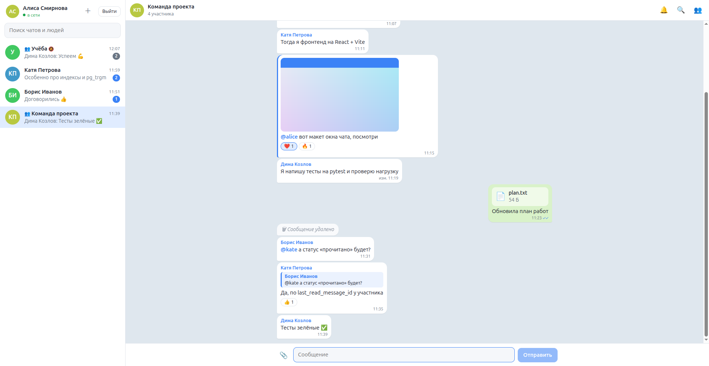
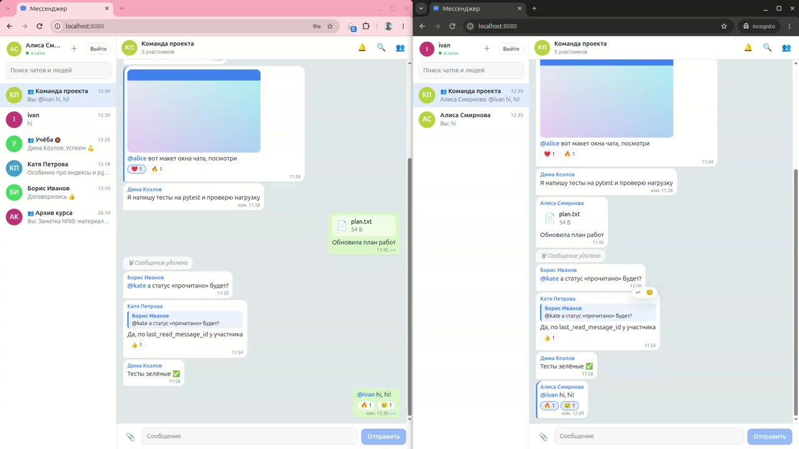
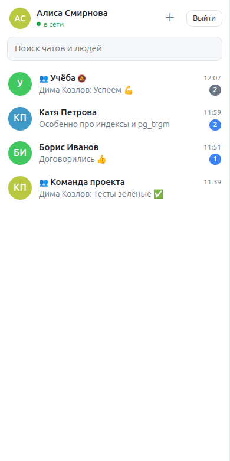
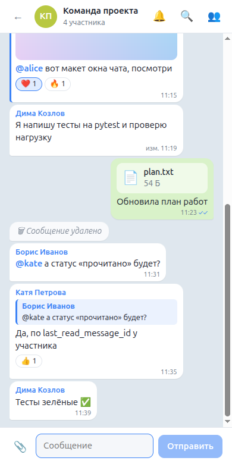
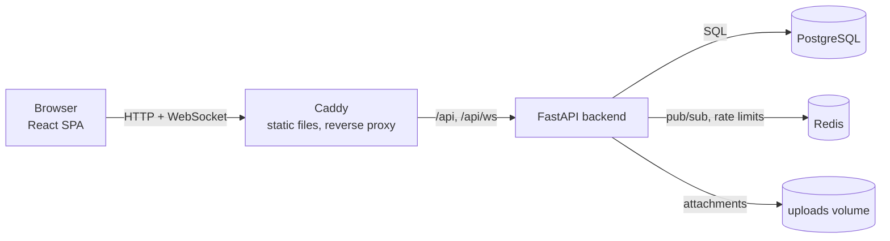
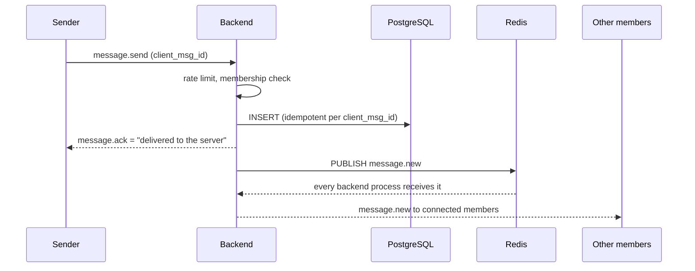

# web-messenger

Real-time web messenger with private and group chats, message history, WebSocket delivery
and basic moderation. Course project for VK Education.



## Demo video

Two users side by side (1:48, no sound): registration, real-time delivery, read receipts,
replies, reactions, mentions, attachments, group management and moderation.

[](docs/demo.mp4)


https://github.com/user-attachments/assets/81936c79-113d-44cc-9641-ff56d58ed2f8


▶ [Watch the video (docs/demo.mp4)](docs/demo.mp4)

## Quick start

Requires Docker.

```bash
cp .env.example .env    # then put a random value into JWT_SECRET, e.g.:
                        # python3 -c "import secrets; print(secrets.token_urlsafe(48))"
docker compose up -d --build
docker compose exec backend python -m app.scripts.seed_demo --reset   # optional demo data
```

- App: http://localhost:8080
- API docs (Swagger): http://127.0.0.1:8000/docs
- Demo accounts (after seeding): `alice`, `bob`, `kate`, `dima`, password `demo-password`.
  To chat as two users at once, use two browsers or a normal and a private window:
  the session cookie is shared between tabs of one browser profile.

## Features

**MVP**

- [x] Registration and login: JWT access token + rotating refresh token (httpOnly cookie)
- [x] Chat list; direct 1-1 chats; group chats with a title
- [x] Real-time messages over WebSocket; history with "load more" (cursor pagination upwards);
      "delivered" status once the server has stored the message
- [x] Members: only an admin adds or removes group members
- [x] Search within a chat by a plain string

**Extensions**

- [x] "Read" status per user (read receipts ✓✓, unread counters)
- [x] Edit and delete messages, with an "edited" mark; group admins can delete any message
- [x] Reactions: 👍 ❤️ 😂 😮 😢 🔥
- [x] Attachments: images and files stored on the server's disk
- [x] @mentions and replies
- [x] Mute (per-chat notification flag)
- [x] Anti-spam: rate limit on sending
- [ ] LLM summarizer (not planned: the project avoids paid external services)

**UI:** login screen, chat list with search, chat window with "load more", modals for creating
a group and managing members. Works on phones too:

<p>
  
  
</p>

## Architecture



Sending a message:



Key decisions:

- **WebSocket, one connection per tab**, multiplexing all chats. REST handles everything else
  (history, search, edits), and both use the same service layer.
- **Redis pub/sub** fans events out, so the backend can run as several processes/containers.
- **Idempotent sending**: the client generates `client_msg_id`, keeps unconfirmed messages and
  resends them after a reconnect without creating duplicates.
- **Cursor pagination** (`before_id`) instead of OFFSET: stable while new messages arrive.
- **Read status as one marker per member** (`last_read_message_id`) instead of a row per message.
- **Search** via `ILIKE` backed by a `pg_trgm` GIN index.
- **Attachments on local disk**, served through signed expiring links; only raster images are
  displayed inline, other files are downloaded, so uploaded HTML/SVG can't run scripts.

## Project layout

```
backend/
  app/
    api/        HTTP and WebSocket routers
    core/       settings, database, redis, security
    models/     SQLAlchemy models
    schemas/    Pydantic request/response models
    services/   business logic shared by REST and WebSocket
    realtime/   event bus (Redis pub/sub → WebSocket connections)
    scripts/    demo data
  alembic/      database migrations
  tests/        pytest: API, WebSocket and realtime tests against real Postgres and Redis
frontend/
  src/
    api.ts            REST client (access token in memory, refresh via cookie)
    realtime.ts       WebSocket client with auto-reconnect
    messagesState.ts  messages reducer (history, pending messages)
    components/       UI
  Caddyfile           web server config for the Docker image
docker-compose.yml
.github/workflows/    CI: tests and linters for backend and frontend
```

# API reference

## Authentication

- `POST /api/auth/register`, `POST /api/auth/login` return a short-lived JWT access token
  (send it as `Authorization: Bearer <token>`) and set a refresh token in an httpOnly cookie
  scoped to `/api/auth`.
- `POST /api/auth/refresh` exchanges the cookie for a new access token. Refresh tokens are
  single-use (rotated on every refresh) and stored only as SHA-256 hashes.
- `POST /api/auth/logout` revokes the refresh token and clears the cookie.

## Chats

- `GET /api/chats` — the user's chats with members; `GET /api/chats/{id}` — one chat
  (404 for non-members).
- `POST /api/chats/direct` — get or create the 1-1 chat with a user (one chat per pair).
- `POST /api/chats/group` — create a group; the creator becomes its admin.
- `PATCH /api/chats/{id}` — rename a group (admin only).
- `POST /api/chats/{id}/members`, `DELETE /api/chats/{id}/members/{user_id}` — add/remove
  members (admin only); any member may remove themselves to leave, except the last admin.

## Messages

- `POST /api/chats/{id}/messages` — send a message. An optional `client_msg_id` (UUID) makes
  retries idempotent: resending returns the stored message instead of a duplicate.
- `GET /api/chats/{id}/messages?before_id=&limit=` — history in chronological order with
  cursor pagination; to load older messages pass `before_id` = id of the oldest loaded one.
- `GET /api/chats/{id}/messages/search?q=` — case-insensitive substring search within a chat,
  newest first (backed by a `pg_trgm` GIN index).
- `GET /api/chats` includes each chat's `last_message` and is ordered by last activity.

## Extensions

- **Read status.** `POST /api/chats/{id}/read {message_id}` moves the member's read marker
  forward. Members expose `last_read_message_id` (read receipts ✓✓), the chat list returns
  `unread_count`, and others get a `read.updated` event.
- **Edit / delete.** `PATCH|DELETE /api/chats/{id}/messages/{message_id}`. Only the author edits
  (sets `edited_at`); the author or a group admin (moderation) deletes. Deletion is soft: a
  "message deleted" placeholder stays, its text, reactions and files are removed.
- **Reactions.** `PUT|DELETE /api/chats/{id}/messages/{message_id}/reactions/{emoji}` with
  👍 ❤️ 😂 😮 😢 🔥; messages carry `reactions: [{emoji, count, user_ids}]`.
- **Replies and mentions.** `reply_to_id` (same chat only) adds a `reply_to` preview.
  `@username` of a chat member is stored as a mention (`mention_user_ids`).
- **Rate limiting.** At most `SEND_RATE_LIMIT` (20) messages per `SEND_RATE_WINDOW_SECONDS`
  (10) per user, counted in Redis across processes; over the limit: HTTP 429 or a
  `rate_limited` WebSocket error.
- **Mute.** `PUT /api/chats/{id}/mute {muted}`: a per-member flag; muted chats don't count
  towards notifications (the unread counter in the tab title).
- **Attachments.** `POST /api/chats/{id}/attachments` (multipart, up to 10 MB) stores the file
  on the server's disk (`UPLOAD_DIR`, a Docker volume) and returns an id to pass in
  `attachment_ids` when sending. Files are served from signed, expiring links
  (`/api/attachments/{id}/{name}?expires=&signature=`) so `` works without headers.
  Only PNG/JPEG/GIF/WebP are shown inline; everything else is downloaded
  (`Content-Disposition: attachment`, `nosniff`), so uploaded HTML/SVG can't run scripts.

## Realtime (WebSocket `/api/ws`)

One connection per browser tab carries events for all of the user's chats.

1. The client sends `{"type": "auth", "token": "<access token>"}`; the server answers `auth.ok`
   or closes the socket with code `4401`.
2. `{"type": "message.send", "chat_id", "text", "client_msg_id", "reply_to_id"?,
   "attachment_ids"?}` stores the message and
   answers `message.ack` (status "delivered to the server"); all chat members then get
   `message.new`. Errors come back as `error` events carrying the `client_msg_id`.
3. Edits, deletions and reactions arrive as `message.updated`, read markers as
   `read.updated`, chat changes (created, renamed, members added/removed) as `chat.updated`.

Events are fanned out through Redis pub/sub, so several backend processes can serve
WebSockets at once. The frontend keeps unconfirmed messages and resends them after a
reconnect; `client_msg_id` makes that safe from duplicates.

# Development

## Running without Docker

Requires [uv](https://docs.astral.sh/uv/) and Docker.

```bash
docker compose up -d postgres redis   # infrastructure only
cd backend
cp .env.example .env   # then set JWT_SECRET
uv sync
uv run alembic upgrade head
uv run uvicorn app.main:app --reload
```

Frontend (Node 24+), in another terminal; Vite proxies `/api` (and the WebSocket) to
`http://127.0.0.1:8000`, override with `BACKEND_URL`:

```bash
cd frontend
npm install
npm run dev        # http://localhost:5173
```

## Tests and linting

Tests expect Postgres and Redis from `docker compose` to be running. They use a separate
`messenger_test` database that is recreated and migrated on every run.

```bash
cd backend
uv run pytest
uv run ruff check . && uv run ruff format --check .

cd ../frontend
npm run build      # type-check + production build
npm run lint && npm run format:check
```

## Migrations

```bash
cd backend
uv run alembic revision --autogenerate -m "describe change"
uv run alembic upgrade head
```
